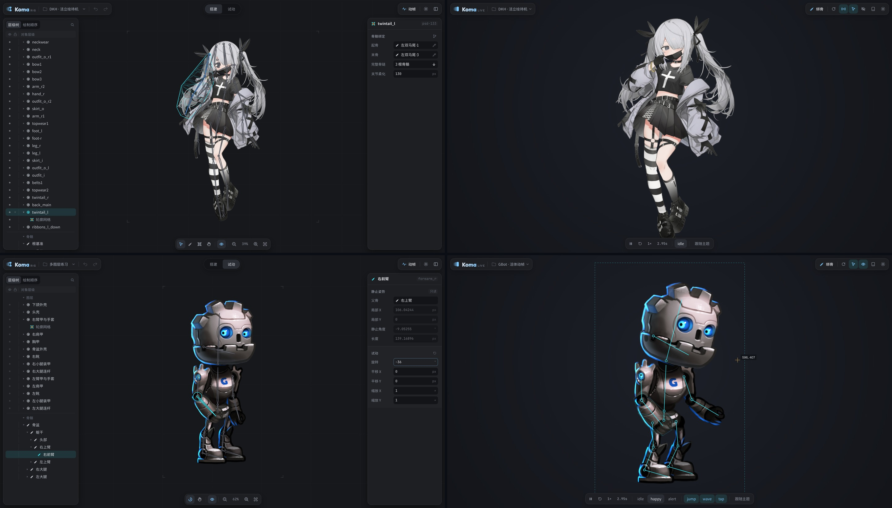

<p align="center">
  
</p>

<p align="center">
  <strong>分层 2D 活立绘创作与实时 WebGL 驱动平台</strong><br>
  在同一个浏览器工作台里完成分层立绘绑骨、轮廓网格校准、实时程序化演出与零漂移前端接入。
</p>

<p align="center">
  <a href="#工作台">工作台</a> ·
  <a href="#前端接入">前端接入</a> ·
  <a href="#ai-演出协作">AI 协作</a> ·
  <a href="#工程架构">工程架构</a> ·
  <a href="#快速开始">快速开始</a> ·
  <a href="#文档导航">文档</a>
</p>



## ✨ 简介

**Koma Live** 是面向「精绘分层立绘 + 前端程序化代码美术」工作流的纯本地 2D 活立绘平台，内置 **Koma Rig** 绑骨底盘，将离线切片核验、骨架网格校准、实时演出预览与解耦 WebGL 运行时收拢在同一套确定性求值内核之上：

- **双工作台一体**：顶栏一键在 **Koma Rig**（绑骨、骨链蒙皮、轮廓网格与试动）与 **Koma Live**（全幅纯净活立绘展示、状态互动、热重载与同轴审查）间互切，切换时自动保活当前作品与演出状态。
- **代码原生软体与骨骼全驱动**：向实时演出脚本完整开放骨骼 **TRS（平移 / 旋转 / 缩放）**、差分槽、ACGN **透发渲染（`peekOpacity` / `peekAfter`）** 与 **M4 代码原生顶点变形口（`deform` Mesh Field）**，兼顾刚体机械与发丝、水母伞、裙摆等软体流体动效。
- **像 Spine / Live2D 一样解耦接入**：独立构建的零编辑器依赖运行时 `player.js` 配合 `rig export-work` 一键导出只读展示包；宿主网页或游戏仅通过 `mountPerformance` 发送语义状态与触发器，零侵入业务代码，支持原生静态图无痕降级。
- **AI 协作与审片闭环**：自带单文件自包含演出契约（`koma-rig.performance.v1`）与 [Agent 演出技能](.agents/skills/koma-rig-animation/SKILL.md)，结合 `rig spec`、`rig check-bend` 与无头 Chromium 审片器 `inspect:live`，实现“绑骨 → 编写物理演出 → 多帧洋葱皮与轨迹验收”的自动化闭环。
- **纯本地工作流**：无云端账号与业务后台，切片、骨架与脚本全部留在本地目录；工作台通过目录句柄与 IndexedDB 记忆最近打开项目，支持原位保存与外部编辑自动热重载。

<a id="工作台"></a>

## 🧩 工作台

### 🦴 Koma Rig · 绑骨、蒙皮与轮廓网格

面向分层 2D 角色的轻量 DCC 绑骨台，默认暗色界面，支持顶栏一键切换暗色／亮色主题：

- **搭建模式**：左侧层级树管理图层显隐、锁定与绘制顺序拖拽；中央画布直接建骨（按住 `Alt` 可建偏移子骨）与调骨；右侧检查器支持骨名原地重命名、拾取改父骨／设为根骨、单骨与连续骨链绑定及关节柔化（`jointSoftnessPx`），以及一键安全轮廓网格与轮廓网格手绘／自动描绘／清除。
- **试动模式**：画布拖拽旋转骨骼，右侧检查器实时试调每根骨骼的完整 **TRS（旋转 / 平移 X·Y / 缩放 X·Y）**；一旦产生网格翻面或自交，画布实时标红出错三角形并阻止静默穿帮。
- **半透明凝胶与透发支持**：全链路采用 sRGB 预乘 Alpha（PMA）与同表面凝胶组 Knockout 合成消除灰黑边；支持图层级 `peekOpacity` / `peekAfter`，让眼角、睫毛与眉毛按设定透明度自然透出刘海与侧发，无需复制纹理。
- **零摩擦载入与导出**：支持直接打开或拖放 `koma-work.json` 作品根目录与纯 `manifest.json` 切片目录、原位保存 `rig.json`、自动监听同步外部改动，以及导出供 AI 与程序化脚本读取的 `rig-spec.json`。

### 🎬 Koma Live · 动帧演出工坊

与最终宿主页面运行**完全同一份 `mountPerformance` 代码**的纯净动帧展台，确保“工坊所见即作品所得”：

- **全幅无干扰画布**：画布占比超过 90%，默认隐藏一切骨架与编辑控件；提供同轴 1:1 DPR 适配的 `back` / `puppet` / `front` 三层画箱与精准的逻辑指针逆变换。
- **契约自动驱动交互条**：底部悬浮栏自动读取演出脚本 `meta.states` 与 `meta.triggers` 生成状态胶囊和互动按钮，并集成播放／暂停、`1× / 0.5× / 0.25×` 慢放、固定步进、复位与底色快切（跟随主题／棋盘格／暗夜／浅色）。
- **实时热重载**：支持在本地目录中直接修改 `rig.json`、`koma-work.json` 或单文件演出脚本 `.js`，通过 Blob URL 自动同步热重载，免刷新即刻看效。
- **同轴审查与卡片框实测**：一键开启只读审查叠加层（实时骨骼线、轮廓网格、逻辑坐标标尺与指针十字读数），切换「居中适屏／底边贴齐／竖卡 360×540／横卡 640×360」实测响应式零漂移；运行期异常自动按 `errorPolicy` 定格上一有效帧并支持一键复制诊断回喂给 AI。

### 🔬 离线工具链 · PSD 切片与动帧验收

- **PSD 去噪切图与像素复验（`tools/psd`）**：Python 离线脚本从分层 PSD 导出 `koma-rig.slices.v2` 切片包，支持 `--trim-stray` 剔除孤立雾噪、`--skip-hidden` 跳过隐藏参考层、`--bake-reference` 按 sRGB PMA 烘焙干净参考图，并通过 `rig verify-slices` 做逐像素 0 误差复验。
- **骨架与网格 CLI 体检（`apps/rig-cli`）**：`rig spec` 导出驱动清单、`rig auto-mesh` 按 Alpha 轮廓批量生成安全轮廓网格、`rig check-bend` 扫描全部骨链的安全转角边界、`rig export-work` 一键纯净导出只读展示包。
- **无头动帧审片器（`inspect:live`）**：用固定步确定性采样 `stepTo(timeMs)` 在真实 WebGL 中抓取多时刻条带、局部特写、洋葱皮、运动弧线与骨骼叠加拼图，便于人工与 AI 逐帧核验穿帮与物理传导。

<a id="前端接入"></a>

## ⚡ 前端接入与解耦运行时

Koma Live 采用与 **Spine / Live2D** 一致的展示型解耦架构：**编辑器留在本仓，宿主业务只消费只读运行时 SDK 与只读角色展示包**，不感知内部骨骼、图层或网格实现。

### 1. 构建独立运行时并导出只读展示包

```sh
# 生成零 Vue / 零编辑器依赖的独立渲染运行时 (packages/rig-renderer/dist/runtime/)
npm run build:runtime

# 将作品导出为纯净只读展示包（自动校验并剔除 setup.json、id-map.json 等制作源文件）
npm run rig -- export-work examples/dkh ./dist-work/dkh --runtime ./dist-work/koma-live --no-poster
```

### 2. 三种运行时入口

`packages/rig-renderer/dist/runtime/player.js` 同时导出三个入口，按接入层级自由选用：

| 入口 | 适用场景 | 核心能力 |
| --- | --- | --- |
| `mountPerformance(host, options)` | **推荐** · 完整活立绘嵌入网页／游戏 | 载入 `koma-work.json` 或 `rig + 单文件脚本`；同轴 1:1 DPR 三层画箱、`fit / anchor` 零漂移缩放、逻辑指针注入、`setState` / `trigger`、`stepTo` 确定性步进、`errorPolicy` 防异常风暴与 `poster` 兜底 |
| `mountLiveRig(host, source)` | 底层自控主循环与直驱 | 载入切片目录或内存资产，每帧直传骨骼 **TRS**、差分槽与 M4 `deform` Mesh Field，返回含骨骼世界坐标的实时 `Pose` |
| `mountPublished(host, root)` | 静态哈希发布包 | 载入经 SHA-256 校验与离线审计打包的静态发布目录（`release.json` + `motions/*.json`） |

### 3. 在真实网页或游戏中挂载

**推荐方式（`mountPerformance`，业务层零耦合骨骼细节）：**

```js
import { mountPerformance } from './vendor/koma-live/player.js'

const live = await mountPerformance(containerEl, {
  work: './works/character/koma-work.json',
  viewport: { fit: 'contain', anchor: [0.5, 1.0] },
  errorPolicy: 'pause',
  onError: (err) => {
    console.warn('Koma Live:', err)
    fallbackToStaticPoster()
  },
})

// 宿主仅发送语义状态与事件，不需要知道任何骨骼名
live.setState('happy')
live.trigger('tap', { x: 420, y: 360 })

// 页面切换或隐藏时暂停省 GPU，卸载时彻底释放 WebGL
live.pause()
live.destroy()
```

**底层单帧直驱（`mountLiveRig` + M4 `deform` 代码原生顶点变形）：**

```js
import { mountLiveRig } from './vendor/koma-live/player.js'

const puppet = await mountLiveRig(canvas, './assets/character/')

function tick(now) {
  const t = now / 1000
  puppet.setPose({
    bones: {
      hip: { y: Math.sin(t * 1.1) * 6, scaleX: 1.03, scaleY: 0.97 },
      head: { rotation: Math.sin(t * 0.8) * 5, x: Math.sin(t * 0.8) * 2 },
    },
    // (u, v) 为切片局部 [0..1]，(x, y) 为原画布静止像素坐标
    deform: {
      ribbon_l: { grid: [3, 10], field: (_u, v) => [Math.sin(v * 5.5 - t * 3.8) * v * v * 12, 0] },
    },
  })
  requestAnimationFrame(tick)
}
requestAnimationFrame(tick)
```

<a id="ai-演出协作"></a>

## 🤖 AI 演出协作

**[打开 AI 活立绘制作与演出技能 · SKILL.md](.agents/skills/koma-rig-animation/SKILL.md)**

Claude Code、Codex、Antigravity 等具备本地文件与命令行能力的 Coding Agent，可以直接沿用本仓内置技能完成从 PSD 切片分析、骨架与轮廓网格规划、单文件物理演出脚本编写到 `inspect:live` 视觉审片的完整流程：

1. 准备好分层 PSD（或切片目录）并放入本仓工作目录。
2. 将下面这段话发给 Coding Agent，填入实际路径与你想要的动作气质。
3. Agent 完成后，在 **Koma Live** 中实时交互验收并按体感微调，确认后通过 `rig export-work` 一键导出接入业务项目。

```text
请先阅读本仓库的 Koma Live 演出技能：
.agents/skills/koma-rig-animation/SKILL.md

请基于 <替换为 PSD 或切片目录路径> 完成去噪切片、骨架与安全轮廓网格规划，
编写符合 koma-rig.performance.v1 契约的单文件实时演出脚本，
并用 rig check-bend 与 inspect:live 完成无穿帮视觉验收。
```

<a id="工程架构"></a>

## 🏗️ 工程架构

各子包职责与依赖边界由 [dependencies.test.mjs](tests/dependencies.test.mjs) 和 Rollup 构建护栏持续强制守卫：

| 模块 | 职责 | 依赖约束 |
| --- | --- | --- |
| `packages/rig-core` | 切片／骨架／作品契约校验、FK 骨骼与骨链蒙皮求值、M4 `deform` 细分与几何防翻面／自交校验 | 仅 `zod`；纯 ES2022，零 DOM、零 WebGL、零渲染依赖 |
| `packages/rig-renderer` | PixiJS v8 WebGL PMA / Knockout / 透发渲染与 `mountPerformance` / `mountLiveRig` 独立运行时 | 依赖 `rig-core` 与 `pixi.js`；严格禁止引入 Vue、Tweakpane 或编辑器模块 |
| `apps/rig-studio` | **Koma Rig** 绑骨台与 **Koma Live** 动帧工坊前端（可静态部署 `apps/rig-studio/dist/`） | Vue 3 + Vite；与运行时产物彻底分离 |
| `apps/rig-cli` | 离线 `rig` 命令行（`verify-slices / spec / auto-mesh / check-bend / export-work`）与无头 `inspect:live` 审片器 | Node.js 原生 API + `rig-core`；零额外运行依赖 |
| `tools/psd` | 离线 PSD 分层切片导出、孤立噪点剔除、PMA 参考图烘焙与像素级差异核验 | Python 3.11+、`uv`、`psd-tools`、`Pillow`、`numpy` |

## 🔒 纯本地存储与隐私

Koma Live 是纯本地运行的前端工作台与命令行工具链，没有云端账号、遥测或业务后台：

- 所有美术切片、骨架文件（`rig.json`）与演出脚本（`.js`）均直接保存在你指定的本机目录中。
- 浏览器仅在本地 IndexedDB 中记录「最近打开」目录句柄、并在 `localStorage` 中保存深浅主题偏好，方便刷新后一键恢复现场。
- `npm run build:studio` 产出的 `apps/rig-studio/dist/` 可作为纯静态站点直接部署，离线即可运行。

<a id="快速开始"></a>

## 🚀 快速开始

本地开发与构建需要 Node.js **26**（[.nvmrc](.nvmrc)）：

```sh
# 安装依赖并启动 Koma Live 本地工作台 (http://127.0.0.1:5186)
npm ci
npm run dev -- --host 127.0.0.1 --port 5186

# 直达动帧工坊或指定本地作品目录
# http://127.0.0.1:5186/?view=live
# http://127.0.0.1:5186/?view=live&work=examples/dkh

# 严格类型检查、独立运行时构建与静态工作台构建
npm run build
```

离线 PSD 导出与像素复验需要 Python 3.11+ 与 `uv`：

```sh
# 单命令去孤立噪点、跳过隐藏参考层并按 sRGB PMA 烘焙干净 reference.png（含 0 误差复验）
uv run --locked --project tools/psd python -m layer_rig_psd.slices drawing.psd character --source-id char --trim-stray --skip-hidden --bake-reference

# 运行离线 PSD 与像素复验单测
uv run --locked --project tools/psd python -m unittest discover -s tools/psd/tests
```

| 常用命令 | 说明 |
| --- | --- |
| `npm run typecheck` | 严格类型检查（`rig-core`、`rig-renderer`、`rig-studio`） |
| `npm test` | 运行 Vitest 核心数学、网格、透发、契约与依赖边界单元测试 |
| `npm run test:offline` | 运行离线 CLI 草稿、重导、审核与单帧弯曲集成测试 |
| `npm run test:studio-layout` | 构建工作台并运行浏览器布局与交互回归 |
| `npm run test:live` | 构建独立运行时与工作台，运行 2× DPR 动帧与 M4 WebGL 回归 |
| `npm run build:runtime` | 构建零编辑器依赖独立前端运行时 `packages/rig-renderer/dist/runtime/player.js` |
| `npm run rig -- spec <目录> [输出.json]` | 导出供程序化脚本与 AI 使用的 `rig-spec.json` 驱动清单 |
| `npm run rig -- auto-mesh <目录> [--dry-run]` | 按 PNG Alpha 轮廓批量生成骨链安全轮廓网格 |
| `npm run rig -- check-bend <目录>` | 扫描全部骨链的安全转角上限并报告翻面风险 |
| `npm run rig -- export-work <作品目录> <输出目录>` | 导出只读展示包（可选 `--runtime <目录>` 同步 SDK、`--no-poster` 省去海报图） |
| `npm run inspect:live -- <作品> --times ...` | 无头 Chromium 固定步采样并合成多帧条带、洋葱皮与轨迹审片板 |

<a id="文档导航"></a>

## 📚 文档导航

- **规格与工作台**：[功能规格](docs/implementation-plan.md) · [工作台说明](docs/studio-layout-plan.md) · [编辑器参考](docs/editor-references.md)
- **演出与验收契约**：[演出契约](docs/performance-contract.md) · [动帧视觉验收](docs/live-inspection-plan.md) · [AI 演出技能](.agents/skills/koma-rig-animation/SKILL.md)
- **离线制作与维护**：[离线制作与验收](docs/offline-authoring.md) · [分层拆分调研](docs/layer-decomposition-research.md) · [维护交接](docs/maintenance-handoff.md)

## 💜 致谢

- **GBot 内置示例角色**：由 Andreas Esau 绘制，素材源自 Godot 文档项目示例（Juan Linietsky、Ariel Manzur 与 Godot 社区），按 [CC BY 3.0](https://creativecommons.org/licenses/by/3.0/) 许可使用（详见 [credits.txt](apps/rig-studio/public/credits.txt)）。
- **Koma 家族设计资产与开源栈**：PixiJS v8、Vue、Vite、Zod、Playwright、psd-tools、Pillow，以及 Resource Han Rounded（资源圆体）、Fredoka、JetBrains Mono 等开源字体与图标项目。
