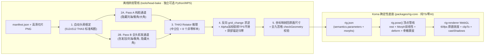

# Koma 轻度 2.5D 头部离线烘焙（Morph 底座 + THA3 烘焙器）需求文档与实施计划（已归档）

> **归档说明**：本文记录 THA3 离线 Python 烘焙器的早期实验方案，现已退役并移除 `tools/head-bake/`；其 **Morph 底座** 已保留于内核，头部九姿态现由零外部依赖的纯 TS 解析式 `npm run rig -- auto-head`（[head-morph.ts](../../packages/rig-core/src/head-morph.ts)）替代。  
> **关联文档**：[设计哲学](../design-philosophy.md) · [核心规格](../rig-spec.md) · [演出契约](../performance-contract.md) · [离线装配](../offline-authoring.md) · [动帧视觉验收](../live-inspection.md)

---

## 一、背景与核心问题

Koma 当前已经跑通 **Spine 式全身骨骼 + 连续网格形变场（`deform`）+ 实时 2D 赛璐璐投影（`castShadows`）+ 表情差分桥接 + `inspect:live` 审片闭环** 的完整管线。

但在角色头部微转（轻度 2.5D / 轻度 Live2D 互动感）场景下，现有纯手写解析投影（如脚本内手写 `projectHead3D(x, y, z)`）存在两个结构性痛点：

1. **轻微鱼眼与气球鼓胀感**：手写高度场 `z(x, y)` 往往中心快、边缘慢，再叠加脸部径向呼吸缩放，容易出现不均匀的橡皮拉扯；
2. **纸片分层滑行感**：脸底、五官、刘海各自手写独立深度值且缺少真正的**二次元远侧脸颊收折（Silhouette Roll）**与**远侧眼眶透视收窄（Far-Eye Foreshortening）**，转头时容易显得像几张平行纸板隔空错位；同时每个新角色都要手写/手调上百行 3D 投影公式，难以规模化提效。

**破局思路**：
- 不走传统 Live2D 人工手搓几十层嵌套变形器的泥潭，也不在运行期运行神经网络重绘（避免 512px 糊图、闪烁、高显存与不可控）；
- 将 **Talking Head Anime 3（THA3，MIT 代码 / CC-BY-4.0 权重）** 这类二次元专用模型当作**离线几何老师**，只抽取其 `two_algorithm_face_body_rotator` 原生预测的 2D 像素位移场 **`grid_change`**，经双通道分层求逆和平滑拟合后，离线烘焙为 **`rig.json` 中的轻量 3×3 参数化网格位移（`morphs`）**；
- 运行时完全在 `packages/rig-core` + WebGL 渲染器内以 60fps 执行确定性双线性插值，**100% 保留高分辨率原画锐度、零运行时 AI 依赖**。

---

## 二、产品边界（严格对齐 [design-philosophy.md](design-philosophy.md)）

> **核心原则**：Koma 坚定以 **Spine 骨骼体系为主干**（全身姿态、肢体、锁地、物理与交互），仅在头部核心图层引入**离线自动烘焙的轻度 2.5D Morph**。绝不试图同时叠加“Spine 全身大动作 × Live2D 大角度九轴”，避免陷入拆层补血与 Z-order 穿帮的维度灾难。

### 1. 明确要做（In Scope）

1. **引擎底座与具体 AI 模型完全解耦**：
   - `packages/rig-core` 新增**通用、声明式、与模型无关的 1D/2D 参数化网格 Morph 底座（`morphs`）**；
   - 无论上游离线烘焙器是 THA3、LivePortrait、3D 二次元代理头模还是其他工具，输出全部统一落盘为 `rig.json` 的标准 `morphs` 字段，运行期零耦合。
2. **严格锁定“轻度 2.5D 甜蜜区”**：
   - 严格遵守 [design-philosophy.md](design-philosophy.md) 的微视差红线，只烘焙中小幅度几何主导区间（THA3 `grid_change` 占主导，不依赖低清 `direct_image` 脑补重画）：
     - **Yaw（左右转头）**：默认烘焙上限 `±12° ~ ±14°`（对应 THA3 `head_y ≈ ±0.45 ~ ±0.60`）；
     - **Pitch（抬头 / 低头）**：默认烘焙上限 `仰 +7° ~ 俯 -12°`（对应 THA3 `head_x ≈ [-0.40, +0.55]`，俯视幅度大于仰视）；
     - **Roll（左右歪头 Z 轴）**：继续由 `bones.head.rotation` 刚性旋转 + 长发重力铅垂驱动，不占 Morph 维度；
     - 演出脚本可在运行时通过参数缩放（如 `0.7× ~ 1.0×`）自由控制最终收敛幅度。
3. **只烘焙头部核心图层，全身仍归 Spine 骨架与程序化物理**：
   - **纳入烘焙的典型图层**：脸底（`face_base`）、面部氛围层（如 `expr_face_gloom`）、眼部全族（`eye_white`、`pupil`、`eye_highlight`、`eye_lash`、`brow`、`lower_lid_*`、`lower_liner_*`、`expr_eyes_*`）、鼻嘴（`nose`、`mouth`、`expr_mouth_*`）、双耳（`ear_l/r`）、头冠与前发（`hair_crown`、`bang_*`、`sideburn_*`、`ahoge_front`）。
   - **保持现有骨骼与物理（不交给 THA3）**：大型头角（`horn_*`）、蝴蝶结与丝带（`bow_* / ribbon_*`）、长背发（`hair_back / hair_mid_* / hair_wispy_*`）、躯干、衣物、四肢、锁链、触手等。
4. **双通道分层无损烘焙**：
   - **Pass A（纯净脸廓 + 五官通道）**：隐藏前刘海、鬓角、呆毛与大型头角，仅合成颈肩 + 双耳 + 脸底 + 五官喂给 THA3，获得零刘海粘连污染的纯净脸部/眼眶位移场；
   - **Pass B（前发层次通道）**：叠加发冠、刘海、鬓角（仍隐藏超大头角）再跑一遍，在各发片 Alpha 掩膜内采样低频位移，形成自然的前后视差层次。
5. **全自动确定性质量门禁**：
   - 离线烘焙器必须输出构图检查图、THA3 原始 9 宫格输出图、前向位移/雅可比诊断图；
   - 写回 `rig.json` 前必须经 `createRig()` 与全九宫格（含插值中点）`checkGeometry()` 校验，保证 **0 三角形翻折 / 自交**，且中性点 `(0, 0)` 误差严格为 **`0.00 px`**（`verify-slices` 零误差）。

### 2. 明确不做（Out of Scope）

- **不做运行期神经网络推理**：浏览器 / Koma Live 播放端零 PyTorch、ONNX、WebGPU ML 依赖。
- **不用 THA3 渲染的 512×512 RGB 像素替换贴图**：只提取几何位移场，100% 保留原画分辨率与线条锐度。
- **不做大角度（`> ±20°`）侧脸强转头与背面补画**：超出轻度 2.5D 区间属于三渲二 3D 赛道。
- **不用 THA3 接管眨眼、差分表情与全身躯干**：眨眼继续走 Koma 高精度分段单调闭缝 + 差分眼桥接，全身保持 Spine 骨骼。
- **不做网页端手工捏九宫格变形器编辑器 UI**：保持离线自动烘焙 + 代码/审片闭环。
- **不将 PyTorch 塞入 `tools/psd`**：离线烘焙依赖严格隔离在独立可选目录 `tools/head-bake/`，不污染轻量级 PSD 切图与去白边工具链。

---

## 三、代码库现状勘探与集成点

下表记录实施前的仓库状态与集成职责：

| 模块 / 文件 | 当前机制 | 本次改动职责 |
| :--- | :--- | :--- |
| `packages/rig-core/src/morph.ts` *(新增)* | 无 | 定义 `morphAxisSchema` / `layerMorphGridSchema`，实现 1D/2D 参数双线性插值、UV 晶格双线性采样与边界校验 |
| `packages/rig-core/src/pose.ts` | `pose()` 目前在 `deform[layerId]` 与 `binding.deformer` 间二选一；`validateGeometry` 默认 `true` | `rigData` 增加 `morphs: z.array(layerMorphGridSchema).default([])`；在 `pose()` 顶点管线中将 `morph` **可叠加地**注入到 `deform` 与 `boneChain` 蒙皮之前 |
| `packages/rig-core/src/authoring.ts` | `editSchema` 支持 `set-mesh`、`set-deformer`、`set-cast-shadows` 等原子操作 | 新增 `{ op: 'set-morphs', morphs: LayerMorphGrid[] }` 事务操作 |
| `packages/rig-core/src/spec.ts` | 导出 `RigSpec`（含 `parameters`、`bones`、`layers`、`slots`） | 保持兼容；确认 `semantics.parameters` 声明 `headYaw`/`headPitch` 时正常导出 |
| `packages/rig-core/src/index.ts` | 统一导出核心类型与函数 | 导出 `morph.ts` 类型与工具函数 |
| `packages/rig-renderer/src/character.ts` | 直接消费 `Part.geometry` 渲染 WebGL `Mesh`，已自动联动 `clipTo` / `peekOpacity` / `castShadows` | **无需大改**（仅验证 Morph 几何更新时 `clipTo` 与 `castShadows` 同步正确） |
| `packages/rig-renderer/src/game.ts` | `LivePoseInput` 已透传 `parameters` 给 `rig.pose()` | 验证运行时通过 `setPose({ parameters: { headYaw, headPitch } })` 直接驱动 `morphs` |
| `apps/rig-cli/rig.mjs` | 现有 `auto-mesh` / `check-bend` / `defringe` / `verify-slices` / `edit` | 可选新增 `rig bake-head` 转发命令（调用独立 Python 环境 `KOMA_HEAD_BAKE_PYTHON` 或 `tools/head-bake/.venv`） |
| `tools/head-bake/` *(新增可选目录)* | 无（`tools/psd` 仅含轻量 `numpy`/`Pillow`） | 独立 Python 项目（`pyproject.toml` + `bake_tha3.py`），安装 `torch` + `scipy` + `numpy` + `Pillow`，权重缓存于 `~/.cache/koma-rig/tha3/` |

> **关键构建提示**：`package.json` 中的 `npm run build:runtime` 会先执行 `tsc -b packages/rig-core packages/rig-renderer` 再运行 Vite 打包。改动 `packages/rig-core` 后必须运行 `npm run build:runtime`，否则 `inspect:live` 和浏览器测试会读取到旧的 `runtime/player.js`。

---

## 四、技术架构与数据流



---

## 五、详细设计规格

### 1. `rig-core` 声明式参数化网格 Morph Schema（`packages/rig-core/src/morph.ts`）

设计要点：**存储在图层的归一化 UV 晶格上，与运行时具体三角剖分完全解耦**。因此同一份烘焙数据可无损叠加在普通切片、`boneChain` 轮廓网格以及任意密度的实时 `deform` 场上。

```ts
export const morphAxisSchema = z.strictObject({
  /** 必须在 rig.json semantics.parameters 中声明 */
  parameter: id,
  /** 严格递增的采样点数组，至少 2 个（如 [-1, 0, 1]） */
  samples: z.array(z.number().finite()).min(2),
})

export const layerMorphGridSchema = z.strictObject({
  layerId: id,
  /** 晶格细分 [cols, rows]，格点数为 (cols + 1) * (rows + 1) */
  grid: z.tuple([z.int().min(1).max(16), z.int().min(1).max(16)]),
  /** 支持 1D（如眨眼/张嘴）或 2D（如 headYaw × headPitch）参数空间 */
  axes: z.union([
    z.tuple([morphAxisSchema]),
    z.tuple([morphAxisSchema, morphAxisSchema]),
  ]),
  /**
   * 每个采样组合对应一组平坦位移数组 [dx0, dy0, dx1, dy1, ...]（静止切片像素单位），
   * 长度须等于 (cols + 1) * (rows + 1) * 2。
   * 休止中性点（如 (0, 0)）允许写为 null，确保休止态零开销、0.00px 误差。
   * 2D 排列顺序：index = iy * axes[0].samples.length + ix。
   */
  deltas: z.array(z.array(z.number().finite()).nullable()),
  /** 可选：几何自检最小面积比阈值（默认沿用 0.01） */
  minRatio: z.number().positive().optional(),
})
```

#### `createRig()` 静态校验规则
1. 每个 `morph.layerId` 必须存在于 `manifest.layers`，同一图层可定义多个 Morph，位移依次累加。
2. 每个 `axis.parameter` 必须存在于 `semantics.parameters`，且 `axis.samples` 严格递增（`samples[i] < samples[i + 1]`）；
3. `deltas.length` 必须严格等于 `axes[0].samples.length`（1D）或 `axes[0].samples.length * axes[1].samples.length`（2D）；
4. 非 `null` 的 `deltas[k]` 长度必须严格等于 `(cols + 1) * (rows + 1) * 2`。

#### `pose()` 运行时计算与叠加顺序（关键！）
对单个图层 `l`：
1. **中立位**。插值只命中零位移时，沿用该帧原有几何；中立位不会引入新顶点。
2. **网格复用**。保留已有脚本、轮廓、FFD、Ribbon 或骨链的几何。按需细分不足的轴，并将静止态的边切分重放到已弯曲的三角面上，补入经骨架变换的 Morph 位移。
3. **两步双线性求值**：
   - **参数空间双线性插值**：将参数值 `clamp` 到 `[samples[0], samples[last]]`，定位所在区间 `[i0, i1]` 与权重 `t ∈ [0, 1]`，把最多 4 个角点的 `deltas` 混合成一张当前姿态的晶格位移表 `lattice`（`Float64Array`，长度 `(cols+1)*(rows+1)*2`）；
   - **UV 空间双线性采样**：对 `restGeometry` 的每个顶点 `k`，用其归一化坐标 `(u, v) = (uv[2k], uv[2k+1])` 在 `lattice` 上做双线性插值，得到 `(mdx, mdy)` 并累加到顶点坐标上；
4. **叠加次级形变与骨骼**：
   - 若存在 `deform[layerId]`，在其上叠加 `field(u, v, restX, restY)`（如眨眼闭缝、视线微调、发梢风摆）；
   - 若存在 `cached.skin`（即 `boneChain`），执行蒙皮；否则保持 rest-local 顶点，由 `part.matrix` 施加单骨世界变换；
5. **几何自检**：注册进 `activeFieldChecks`，在 `validateGeometry: true`（Studio / CLI / `inspect:live`）时自动过 `checkGeometry()`。

> 本地实机样板使用 30 个目标图层。紧凑序列化的 Morph 列表约 196 KiB，gzip 后约 68 KiB，包含眼、口配准所需的五位小数。播放帧率取决于设备、画布、阴影和完整演出脚本。

---

### 2. 离线 THA3 双通道分层烘焙器（`tools/head-bake/bake_tha3.py`）

#### (1) 模型与许可规范
- 上游仓库：`pkhungurn/talking-head-anime-3-demo`（MIT License）；
- 推荐模型：`separable_float`（Apple Silicon MPS / CPU 稳定、精度高于 half）；
- 权重目录：默认 `~/.cache/koma-rig/tha3/`，支持 `--weights-dir` 指定，同时提供下载脚本/提示（支持 HuggingFace 镜像如 `ksuriuri/talking-head-anime-3-models`）；
- **许可与署名**：项目文档与 `tools/head-bake/README.md` 中明确注明 THA3 代码为 MIT、预训练权重为 CC-BY-4.0（原作者 Pramook Khungurn）。

#### (2) 自动头肩构图框定（Canonical `512×512` Framing）
THA3 是在标准二次元半身像分布上训练的（头部大致居中偏上、颈肩可见、透明底）：
- 读取配置的 `headLayers` 联合边界或显式 `faceBox`。默认裁切边长为头部最大边的四倍，将头放在标准 512 输入上半部中央的 128 像素方框内。
- 使用 `eyeAnchorLayers`、`scaleFactor` 和 `eyeTargetYRatio` 可选择按眼位构图。
- `framing_preview.png` 并排显示脸部、前发两个通道及标准头框。

#### (3) 双通道分层合成与 THA3 推理
- **采样网格**。每个通道使用 3×3 九个姿态，中立位用于测量模型自身的位移偏差；两通道共 18 次推理。
  - `headYaw` 按上游名称映射到 `head_y`（索引 40），幅度 0.50。
  - `headPitch` 映射到 `head_x`（索引 39），仰、俯幅度分别为 0.38、0.52。两轴支持配置符号并检测原画鼻部探针的方向。
  - **其余 43 维全部置 0**（包括 `iris`、`eye_blink`、`mouth`、`neck_roll`、`body_*`），确保提取出的场是纯粹的 `Yaw × Pitch` 2.5D 透视场。
- **Pass A（纯净脸廓 + 五官通道）**：
  - 仅合成：`torso / collar`（提供颈肩锚定，不导出其 Morph）+ `ear_l/r` + `face_base` + `eye_white / pupil / eye_highlight / eye_lash / brow / lower_lid_* / lower_liner_* / nose / mouth`；
  - 隐藏：所有前刘海、鬓角、呆毛、头角、后发、漫符；
  - 读取原生 Rotator 位移场 `[1,2,256,256]` 和 Editor 位移场 `[1,2,512,512]`。输出两种纯几何 warp 与原始渲染供审片，记录 Editor 的可见区域平均颜色修正权重。默认选用 Rotator 的低频位移。
- **Pass B（全头前发通道）**：
  - 在 Pass A 基础上额外显示：`hair_crown`、`bang_*`、`sideburn_*`、`ahoge_front`（仍隐藏超大头角 `horn_*` 与长背发 `hair_back`）；
  - 再次提取 `grid_change`，用于拟合前发层与发冠的位移场，使前发自然覆盖并滑行在脸廓之上。

#### (4) 反向 Warp 求逆 + Alpha 加权低频 TPS 拟合 + 颈部归零
设 THA3 在归一化坐标 $[-1, 1]^2$ 下的反向采样场为 $\mathbf{g}(\mathbf{q})$（满足 $\mathbf{p} = \mathbf{q} + \mathbf{g}(\mathbf{q})$）：

1. **中立位相对求逆**。在原画坐标中，材料点的源位置为 `source = p + g0(p)`。求解 `q + gpose(q) = source`，以 `q = p` 开始，按 0.75 阻尼迭代至残差小于 0.01 px 或达到 60 次。前向位移为 `q - p`，求逆验收上限为 0.05 px。
2. **颈部支点刚性归零**：
   在 `neck` 顶端与 `face_base` 下颌交界处采样锚点位移 $\mathbf{d}_{\text{neck}}$（或加权颈部区域中位数），对全部头部层统一减去 $\mathbf{d}_{\text{neck}}$，避免转头时头和脖子发生平移脱节。
3. **分组共享场与低频 TPS 平滑（防穿帮与防翻折的核心）**：
   - **脸部核心共享组（Pass A 场）**：在 `face_base`（含五官区域）内部高不透明度像素（`alpha > 0.6`）均匀下采样 ~300–500 个控制点，用带平滑正则项的 **Thin-Plate Spline（`scipy.interpolate.RBFInterpolator(..., kernel='thin_plate_spline', smoothing=...)`）** 拟合出连续光滑的脸部前向位移场 $F_{\text{face}}(x, y)$；
     - `face_base`、`expr_face_gloom`、`eye_white`、`pupil`、`eye_highlight`、`eye_lash`、`brow`、`lower_lid_*`、`lower_liner_*`、`nose`、`mouth`、`expr_eyes_*`、`expr_mouth_*` **全部从同一函数 $F_{\text{face}}(x, y)$ 在各自切片晶格点求值**！
     - 脸底与阴影共用晶格。不同切片在眼、口区域内使用共同的局部仿射拟合以保持配准，掩膜及差分按渲染器实际三角面验收。本地样板的 7,500 次眼部采样中，最大相对偏差小于 0.000011 px。
   - **双耳组（Pass A 场）**：在 `ear_l` / `ear_r` 各自 Alpha 掩膜内采样拟合（或叠加到脸部场的外推平滑过渡）。
   - **前发组（Pass B 场）**：对 `hair_crown`、`bang_*`、`sideburn_*`、`ahoge_front` 在各自 Alpha 掩膜内采样 + 高平滑度 TPS 拟合；对超出 `512×512` 底部边界的较长鬓发末端，按距离平滑过渡/衰减至头骨基底位移，避免外推发散，末端摆动仍由 Koma 物理/风场接管。
4. **雅可比与防翻折自动保护**：
   - 对每个图层、每个 3×3 采样角点检查晶格单元的局部雅可比行列式（最小面积比 `minRatio >= 0.15`）；
   - 若某个极端角点出现过度压缩，同步衰减该姿态所有目标层的位移（如 `0.9×` 迭代退火）直到 100% 满足 `minRatio >= 0.15`，最后再交由 Node 端 `createRig()` + 全九宫格（含 4 象限中点）`pose(..., { validateGeometry: true })` 做终检。

#### (5) 角色级烘焙配置（`head-bake.json` 示例）

以下是历史 THA3 实验方案的精简配置示例（现行零依赖 `head-rig.json` 请见 [离线装配](../offline-authoring.md)）。

```json
{
  "format": "koma-rig.head-bake.v1",
  "backend": "tha3",
  "model": "separable_float",
  "parameters": {
    "yaw": { "id": "headYaw", "tha3Amplitude": 0.50, "sign": -1 },
    "pitch": { "id": "headPitch", "tha3Up": 0.38, "tha3Down": 0.52, "sign": -1 }
  },
  "framing": {
    "faceLayer": "face_base",
    "headLayers": ["face_base", "hair_crown"],
    "neckAnchor": [703, 803],
    "directionProbe": [695, 716]
  },
  "passes": {
    "faceContextLayers": ["torso", "collar", "ear_l", "ear_r", "face_base", "lower_lid_r", "lower_lid_l", "mouth", "nose", "eye_white", "pupil", "lower_liner_r", "eye_highlight", "lower_liner_l", "eye_lash", "brow"],
    "hairContextAddLayers": ["hair_crown", "bang_r", "bang_l", "sideburn_l2", "sideburn_l1", "sideburn_r2", "sideburn_r1", "bang_c", "ahoge_front"]
  },
  "targets": {
    "sharedFaceGroup": {
      "pass": "face",
      "gridDefault": [6, 6],
      "layers": {
        "face_base": [8, 8],
        "expr_face_gloom": [8, 8],
        "eye_white": [6, 3],
        "pupil": [6, 3],
        "eye_highlight": [6, 3],
        "eye_lash": [6, 3],
        "brow": [6, 2],
        "lower_lid_l": [4, 2],
        "lower_lid_r": [4, 2],
        "lower_liner_l": [4, 2],
        "lower_liner_r": [4, 2],
        "nose": [2, 2],
        "mouth": [2, 2],
        "expr_mouth_o": [2, 2],
        "expr_mouth_frown": [2, 2],
        "expr_eyes_sleepy": [6, 4],
        "expr_eyes_star": [8, 6],
        "expr_eyes_abyss": [8, 8]
      }
    },
    "independentLayers": {
      "ear_l": { "pass": "face", "grid": [4, 4] },
      "ear_r": { "pass": "face", "grid": [4, 4] },
      "hair_crown": { "pass": "hair", "grid": [8, 6] },
      "bang_l": { "pass": "hair", "grid": [4, 6] },
      "bang_c": { "pass": "hair", "grid": [6, 8] },
      "bang_r": { "pass": "hair", "grid": [4, 6] },
      "sideburn_l1": { "pass": "hair", "grid": [6, 8] },
      "sideburn_r1": { "pass": "hair", "grid": [6, 8] },
      "sideburn_l2": { "pass": "hair", "grid": [6, 6] },
      "sideburn_r2": { "pass": "hair", "grid": [6, 6] },
      "ahoge_front": { "pass": "hair", "grid": [6, 8] }
    }
  }
}
```

---

## 六、分阶段实施清单与验收门禁

### Phase 1：`packages/rig-core` 通用 `morphs` 底座（零 AI 依赖）
- [x] 新增 `packages/rig-core/src/morph.ts`：Schema、校验、1D/2D 双线性插值、UV 晶格采样与累加工具；
- [x] 更新 `packages/rig-core/src/pose.ts`：接入 `rigData.morphs`，在 `pose()` 中实现「`rest` + `morph` + `deform` + `boneChain` 蒙皮」的可叠加顶点管线与几何自检；
- [x] 更新 `packages/rig-core/src/authoring.ts` 与 `packages/rig-core/src/index.ts`：支持 `set-morphs` 事务操作与类型导出；
- [x] 新增 `packages/rig-core/test/morphs.test.ts`：覆盖中性点 0 误差、1D/2D 边界与插值精度、与 `deform` 叠加、与 `boneChain` 叠加、非法 schema / 三角形翻折拦截；
- [x] 更新 `docs/rig-spec.md` 与 `.agents/skills/koma-rig-animation/references/tools-and-contracts.md`；
- [x] **门禁**：`npm run build:runtime && npm test && npm run test:live` 全部通过。

### Phase 2：`tools/head-bake` 离线 THA3 双通道烘焙器
- [x] 新建 `tools/head-bake/pyproject.toml` 与独立 `.venv`（支持 Apple Silicon MPS，自动回退 CPU，绝不污染 `tools/psd`）；
- [x] 接入 `talking-head-anime-3`（MIT）推理代码与权重缓存管理（`~/.cache/koma-rig/tha3/`，CC-BY-4.0 署名说明）；
- [x] 实现 `bake_tha3.py`：自动头肩框定 → Pass A / Pass B 推理 → `grid_change` Hook 提取 → 阻尼不动点求逆 → 颈部归零 → 分组 Alpha 加权 TPS 拟合 → 雅可比自检退火 → 调试图板输出 → 经 `rig edit` / schema 校验落盘 `rig.json`；
- [x] 新增 Python 单元测试 `tools/head-bake/tests/test_warp.py`（使用解析已知扭曲场验证求逆精度 `< 0.05 px`、TPS 拟合误差与中性点归零，不依赖大模型下载即可在 CI 运行）；
- [x] **门禁**：人工核查调试图板 `framing_preview.png`、`tha3_raw_9grid.png`、`warp_field_viz.png`，确认构图对齐、左右/上下方向完全正确、雅可比全程正定。

### Phase 3：本地样板角色实机接入与 9 宫格 A/B 审片
- [x] 对本地样板角色（如 `examples/<character>/`）执行 `bake_tha3.py` 烘焙 `3×3` Morph 写入其 `rig.json`；
- [x] 精简角色演出脚本（如 `motion/*-live.js`）：
  - **彻底移除脸部径向气球呼吸波（`radDx/radDy` 与 `faceMidRadialScale`）**；
  - 用 `parameters: { headYaw, headPitch }` 替代手写 `projectHead3D`（仅保留眨眼闭缝、视线微调、发梢风摆等纯次级 `deform`）；
  - 收敛大型头角（`horn_*`）Z 轴跨度（由过大广角跨度收拢至符合头骨比例），并将 `face_mid / bangs_anchor / ear_*` 的手写 3D 平移归零避免双重位移；
- [x] 使用 `npm run inspect:live` 渲染 **9 宫格头转图板**（`Yaw ∈ {-1, 0, +1} × Pitch ∈ {-1, 0, +1}`）+ **旧版 vs 新版同框 A/B 对比板** + **全表情状态转头验证板**，必须逐张人工读图验收；
- [x] **硬性验收标准**：
  1. 无鱼眼鼓胀，脸底与五官贴合无“平行纸板滑行”，远侧脸颊与远侧眼眶呈现自然二次元立体收折；
  2. `clipTo: eye_white`、额头阴沉阴影层与全部表情差分在转头极限角下 0 错位、0 穿帮；
  3. 实时 2D 投影（`castShadows`）随 Morph 变形后的刘海与脸廓自动贴合；
  4. `npm run rig -- verify-slices` `mismatches: 0`、`check-bend` `warnCount: 0`、`inspect:live` 遥测 `errorCount: 0`、`maxRigidScaleErr === 0`、`maxFootDriftPx < 0.25 px`。

---

### 本地样板实机记录

中立位 1408 × 2944 WebGL 截图逐像素一致。四种表情的 36 个角度帧及 12 帧实际过渡均无几何错误。切片复验零超差，11 条骨链零警告；刚体缩放误差与双脚起止点漂移在三位小数遥测下均为零。Apple M2 的 Chromium/Metal 在 960 × 720、DPR 1 演出下，239 个帧间隔平均 59.74 fps，P95 17.6 ms。

## 七、给接手 AI 的关键避坑备忘

1. **私有美术资产红线**：`examples/` 下的本地未追踪角色切图与私人原画严禁提交到 Git，也不得在公共文档或代码注释中写入个人绝对路径。
2. **浮点边界安全**：所有传给 `rig.pose()` `opacity` 的表达式必须 `clamp(..., 0, 1)`（`smootherstep(0.9999999999999999)` 在 IEEE-754 下会溢出为 `1.0000000000000013` 触发校验报错）。
3. **测试与构建命令**：
   - 修改 `packages/rig-core` 或 `packages/rig-renderer` 后，先跑 `npm run build:runtime` 再跑 `npm run test:live` 或 `inspect:live`；
   - `tools/psd` 的单测使用 `tools/psd/.venv/bin/python -m unittest`；
   - 切勿对带漫画白色描边的漫符切片执行 `rig defringe`，且严禁改动角色 `face_base` 下巴尖像素。
4. **PixiJS v8 投影坑点（已修复勿回退）**：`packages/rig-renderer/src/character.ts` 中 `castShadows` 已通过先在 `clipRoot` 内完成 Alpha 裁切再以无 mask `multiply` 精灵绘制来规避 PixiJS v8 的 `AlphaMask + multiply` 发黑 Bug，且默认 `blur: 0` + 紧致受影 AABB 保持 60fps，改动渲染器时请勿破坏该路径。
