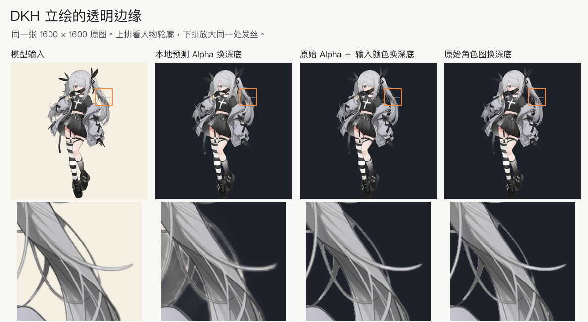

# 单张立绘拆层调研

2026-11-21 · 面向 Koma Image 的拆层制作与 Koma Live 的绑骨、试动

**首轮选型建议用同一张立绘对照 SAM2 Playground 和 See-through。** 前者让用户选部件，直接从原图取像素，适合检验线条和上色能保留到什么程度。后者自动识别动漫角色部件并补画遮挡，适合衡量能省多少手工。若返工主要集中在手臂遮住躯干、刘海遮住额头等位置，再用 RevealLayer 做局部对照。

本次实际运行了 DKH 切片复合校验和本地 IS-Net 整人抠图。下列八套拆层工作流的能力依据项目源码、模型卡或官方工作流，云端接口与价格依据厂商文档。八套方案的同图画质和实际云端费用仍待测量。

## 1. 开源工作流分别能拆出什么

| 项目 | 输入与输出 | 适合解决的问题 |
| --- | --- | --- |
| **SAM2 Playground** | 在原图上用点或框选部件，导出含原图和多个 `Part` 层的 PSD。导出代码保留输入 RGB，用分割蒙版写入 Alpha。 | 保住可见区域的线稿、纹样和高光。底层仍有完整原图，移动部件前要清掉重复像素并补底；细发丝还需软边处理。[项目](https://github.com/jhj0517/sam2-playground) · [PSD 导出代码](https://github.com/jhj0517/sam2-playground/blob/master/modules/mask_utils.py) |
| **See-through** | 针对单张动漫角色图，分出头发、脸、眼睛、衣服等最多 23 个主要语义层，推断层序、补全遮挡并导出 PSD。另有独立的 19 部件分割示例。 | 与可动立绘最接近。可分别试分割模块和完整生成流程，观察补画对原画的影响。作者报告 1280 分辨率默认约需 12–16 GB 显存，另有约 8 GB 的量化路径。[项目与权重](https://github.com/shitagaki-lab/see-through) · [ComfyUI 工作流](https://github.com/jtydhr88/ComfyUI-See-through/blob/98d754bf04f668647919ab750eccb0e0640faa81/workflows/seethrough-basic.json) |
| **RevealLayer** | 输入合成图及目标框，生成对象 RGBA 层和背景，重点处理对象互相遮挡后的形状与内容。 | 想单独拆出手和袖口时，可由用户框定目标。官方主要面向自然场景，动漫线稿的保真度需单测。[官方项目](https://github.com/360CVGroup/RevealLayer) · [手动画框工作流](https://github.com/Ltamann/ComfyUI-TBG-RevealLayer/blob/main/workflows/TBG_RevealLayer_Manual.json) |
| **Qwen-Image-Layered** | 按给定层数生成多张 RGBA，可对某一层递归细拆。官方界面支持 PSD、ZIP 和 PPTX。 | 适合先拆人物、背景和大件道具。官方将提示词定义为整图描述，逐层指定“第几层必须是左眼睑”超出当前控制能力。[官方实现](https://github.com/QwenLM/Qwen-Image-Layered) · [ComfyUI 官方示例](https://docs.comfy.org/tutorials/image/qwen/qwen-image-layered) |
| **LayerDivider** | 原版按颜色聚类，分解底色与效果层，可输出普通图层及带混合模式的 PSD。ComfyUI 版另有基于 SAM 区域蒙版的工作流。 | 适合调色、拆阴影和加工可见区域。颜色相近的袖口和裙摆仍可能需要人工分件。[原项目](https://github.com/mattyamonaca/layerdivider) · [工作流和示例 PSD](https://github.com/jtydhr88/ComfyUI-LayerDivider) |
| **LayerD** | 面向平面设计，逐层提取文字、图形和图像元素，输出 RGBA、PSD 或 SVG。 | 适合卡面、海报与装饰元素。其前景色估计和边缘细化也值得用于研究浅色发丝换底后的白边。[项目](https://github.com/CyberAgentAILab/LayerD) · [推理选项](https://github.com/CyberAgentAILab/LayerD/blob/main/docs/inference.md) |
| **SynLayers** | 先由视觉语言模型生成整图描述和对象框，再由基于 FLUX 的模型生成各区域的透明层。 | 两阶段之间可以呈现“准备拆哪些对象”，便于工作台加入人工校正。官方完整流程列出的要求为 NVIDIA 显卡、至少 24 GB 显存。[实现与权重](https://github.com/YangHaolin0526/SynLayers) |
| **CLD** | 输入合成图、描述和各层布局框，输出逐层 RGBA PNG 及复合预览，使用 FLUX.1-dev、适配器和项目权重。 | 适合已有部件框、需要控制每一层位置的实验。[项目](https://github.com/monkek123King/CLD) · [逐层导出实现](https://github.com/monkek123King/CLD/blob/main/infer/infer.py) |

ComfyUI 节点是相应模型的操作入口，选择时可直接比较其工作流。另有两项相关研究值得跟踪。**Bunraku** 研究单图到可编辑 Live2D 角色，核查时作者仓库仅有 README 与项目页链接。**Anime-layers** 展示线稿、平涂、阴影和高光四层分解，公开仓库以页面和结果图为主。许可也应分别查看代码与权重，例如 Qwen-Image-Layered 标注 Apache 2.0，See-through 的代码采用 Apache 2.0，其 LayerDiff 主权重标注 OpenRAIL++。[Bunraku](https://github.com/SparcAI-Inc/Bunraku) · [Anime-layers](https://github.com/zty0304/Anime-layers) · [Qwen 许可](https://github.com/QwenLM/Qwen-Image-Layered#license-agreement) · [See-through 主权重](https://huggingface.co/layerdifforg/seethroughv0.0.2_layerdiff3d)

## 2. 厂商接口与本地抠图模型

| 候选 | 接口能交付什么 | 在 Koma 中的用途 |
| --- | --- | --- |
| **Seedream 图层拆分** | `layer_decomposition=true` 接收单图，可用提示词指定想拆的元素。5.5 上限为 1 张底图＋99 层，5.0 Pro / Flash 为 1＋16 层。返回透明 PNG、名称、边界框和 `z_index`，框坐标基于**输出底图**。 | 最接近直接导出 Koma 切片的云端接口，但目前 Koma Image v0.8.0 的适配器显式拦截此模式。接入时需保留层元数据并映射回原画布。按调研日 5.5 公开价，1 张输入、10 张输出且每张输出均不超过 2.61 MP，估算为 ¥0.05＋10 × ¥0.13＝**¥1.35**。[火山接口](https://docs.volcengine.com/docs/ark/image-generation-api?lang=zh) · [定价](https://docs.volcengine.com/docs/ark/model-pricing?lang=zh) · [Koma 适配代码](https://github.com/hasheeper/koma-image/blob/08f8f47264074b4bac4207be7fd443e2993101f5/src/gateway/native-protocols.ts#L118-L138) |
| **NovelAI Director Tools** | Koma Image 已接入去背景。一次产生 `Masked`、`Generated` 和 `Blend`。前者用蒙版裁原图，后两者分别为生成重建和混合结果。 | 可直接用 `Masked` 建立整人抠图基线，用另外两份对照补画带来的细节变化。[厂商说明](https://docs.novelai.net/en/image/directortools/) · [Koma 接入说明](https://github.com/hasheeper/koma-image/blob/08f8f47264074b4bac4207be7fd443e2993101f5/docs/integrations/novelai.md#director-tools) |
| **Gemini / OpenAI Images** | Gemini 图像理解可按文字返回目标框与分割结果。OpenAI Images 支持生成透明背景图。 | 前者适合提出部件选区，分割置信度还需转成边缘覆盖率；后者适合制作配件或补画遮挡，定稿部位需核对画风和位置。[Gemini 分割文档](https://ai.google.dev/gemini-api/docs/image-understanding#segmentation) · [OpenAI 图像文档](https://developers.openai.com/api/docs/guides/image-generation) |
| **Photoroom / remove.bg** | Photoroom 可取 `channels=alpha`，但单独的蒙版会跳过透明成品的边缘精修，Basic 公开价约 US$0.02/张。remove.bg 的 ZIP 同时给出灰度 `alpha.png` 和做过边缘颜色校正的 `color.jpg`。 | 比较发丝时同时比较透明成品、蒙版和换底显示。即使 Alpha 准确，边缘 RGB 仍可能带着旧背景颜色。[Photoroom 蒙版](https://docs.photoroom.com/remove-background-api-basic-plan/download-the-segmentation-mask) · [定价](https://www.photoroom.com/api/pricing) · [remove.bg 输出格式](https://www.remove.bg/api) |
| **阿里云通用分割 / fal 托管 SAM 3** | 阿里云可返回主要物体的四通道 PNG 或单通道蒙版。fal 的 SAM 3 支持文字、点和框提示。 | 整体主体与指定部件可分别对照，尤其适合评估用户框选能否减少返工。[阿里云接口](https://api.aliyun.com/api/imageseg/2019-12-30/SegmentCommonImage) · [fal 接口](https://fal.ai/models/fal-ai/sam-3/image/api) |

本地抠图可先用 **SkyTNT Anime Segmentation / IS-Net** 做动漫整人基线，再用 **BiRefNet HR-matting** 对照高分辨率透明边缘。对指定部件，可用 **SAM 2.1** 通过点或框得到初选，再把确定前景、确定背景和待定边缘交给 **ViTMatte** 估计连续 Alpha。本次实际运行的是 IS-Net。[IS-Net 权重](https://huggingface.co/skytnt/anime-seg) · [BiRefNet 模型卡](https://huggingface.co/ZhengPeng7/BiRefNet_HR-matting) · [SAM 2](https://github.com/facebookresearch/sam2) · [ViTMatte](https://huggingface.co/docs/transformers/en/model_doc/vitmatte)

## 3. DKH 实测中的发丝与遮挡

取仓库中 1600 × 1600 的 DKH 角色透明参考图，分别铺到浅米色、蓝灰斜纹背景。只将铺平后的 RGB 缩放到 1024 × 1024，交给本机 CPU 上的 IS-Net ONNX，预测 Alpha 再缩回原尺寸。原始 Alpha 留作真值。轮廓交并比以 0.5 为阈值；两项边缘误差取原始透明度在 10%～90% 的 **10,416 个像素**，按 0～255 计，越低越好。[DKH 参考图](../examples/dkh/slices/reference.png) · [实测权重版本](https://huggingface.co/skytnt/anime-seg/tree/493cb60893f47441b26ec4fb9a306bce9e342982)

| 铺平背景 | 人物轮廓交并比（IoU） | 预测 Alpha 的边缘平均绝对误差 | 使用真实 Alpha、保留铺平 RGB，换深底后的边缘 RGB 平均绝对误差 |
| --- | ---: | ---: | ---: |
| 浅米色 | 97.06% | 57.02 | 28.12 |
| 蓝灰斜纹 | 98.09% | 59.13 | 8.47 |

第二列的独立发丝之间有雾状残留。第三、四列则用了同一个真实 Alpha 和同一种深色背景，只换了 RGB 来源，第三列发丝仍偏亮。这说明编辑器要让用户分别修**透明度**和**旧背景混入的边缘颜色**。两种背景都来自同一角色，这组数据可用于定位问题，尚不足以排名其他模型。

部件移动还会暴露另一种缺失。按 DKH 原有 48 层的默认层序统计，左马尾有 **17,383 / 38,234（45.5%）** 的完全不透明像素被更上方的完全不透明像素遮住，内裙为 **31,412 / 41,315（76.0%）**。这套已有切片静止复合后，每通道容差 1 下超差像素为 0；从单张成图重新拆件时，被挡住的颜色和纹样仍只能推测，必须挪开前景才能检查。[切片与层序](../examples/dkh/slices/manifest.json) · [像素复验方法](offline-authoring.md)

## 4. 接到 Koma Live 的最小验证

1. **只测马尾、手和眼睛。** 马尾看细发丝及孔隙，手挪开后看衣服底层，眼睛看线稿、高光和眼睑层序。给 SAM2 Playground 和 See-through 相同的平面输入，已有分层只在最后用作对照。
2. **分别验可见像素和补画。** 对确认属于该部件的可见实色区域，优先取原图。对半透明边缘切换黑、白、彩底观察。对新露出的遮挡区单独接受或修改补图，避免将前景轮廓重复烘进后层。
3. **导出已有切片格式。** 建议在 Koma Image 新增 `koma-rig.slices.v2` 导出，写出 `manifest.json`、独立的 `reference.png` 和 `textures/*.png`。保持稳定的 `layerId`，按原画布记录裁切矩形和从后到前的层序。Koma Live 的绑骨工作台支持从只有切片的目录建立空骨架。[切片格式](../packages/rig-core/src/slices.ts) · [工作台加载逻辑](../apps/rig-studio/src/project.ts)
4. **用实际动作比较返工量。** 先做静止复合与独立参考的像素对照，再在 Koma Live 里试马尾摆动、眨眼和手部位移。记录每个部件手修所需时间、换底后仍可见的杂边，以及动作中最先露出的缺口，作为选择默认工作流的依据。
