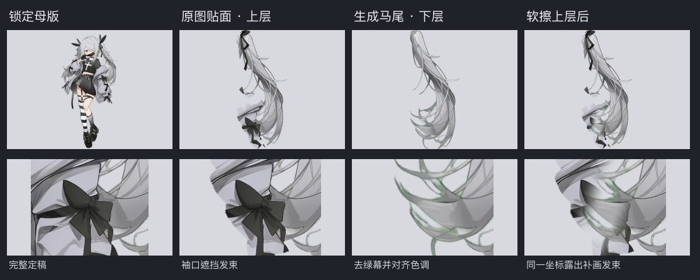
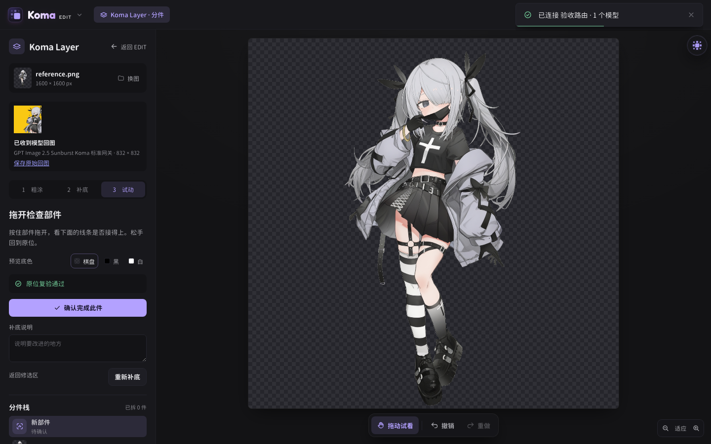
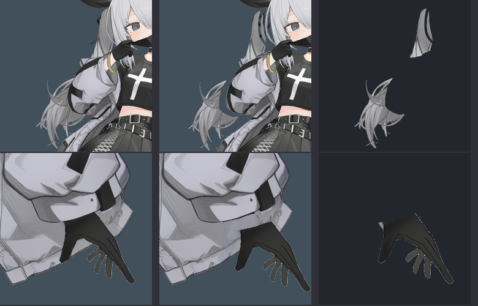

# Koma Layer · 立绘分件工作台设计评审

2026-11-21 · 源码评审基线为 Koma Image v0.8.0（`08f8f47`）与 Koma Live / Rig（`7a78687`）。第 4–5 节记录现行的双层组件编辑与 DKH 验收，第 1–3 节和第 6 节保留初版补底方案的评审与实验。

**Koma Layer**（站内代号 **LAYER**）在 Koma Image 的 EDIT 里孵化，沿用画布、缩放坐标、聚焦重绘与表单托盘。代码、检查点和制作草稿归独立的 `layer` 模块。本轮已实现单向 PSD 导出。ASK 分件蓝图、微件协作与顶栏独立工作区留待两件样板的实际制作工时验证。

下游入口已经实测打通。把 DKH 的 `manifest.json`、`reference.png` 和 `textures/` 单独放进一个目录，在本次构建的绑骨工作台用 Chromium 打开，看到 **48 个图层、0 根骨骼**，画布正常显示。原包经 CLI 复验，最大通道偏差为 1，超差像素为 0。再让左马尾的裁切位置向右错 1 像素，工作台检出 **19,901 个超差像素**，最大偏差 255，保留了上一个有效项目。这个试验用的是已有美术切片。Koma Image 从单张定稿制作出同等质量的切片，仍是原型要验证的目标。[DKH 切片清单](../examples/dkh/slices/manifest.json) · [目录加载](../apps/rig-studio/src/project.ts) · [像素校验](../apps/rig-studio/src/proof.worker.ts)

## 1. 初版评审的剥离与补底方案（历史）

| 环节 | 对原方案的判断 | 建议落到工作台的行为 |
| --- | --- | --- |
| 建项目，锁定 `#f` | 保留。先定清楚验收的是整张插画还是透明角色。 | 冻结收藏记录身份、原件摘要、方向、画布宽高和独立的 sRGB 参考 PNG。标准 PNG 可直接保留，其他输入先按约定方向和色彩解码一次。带背景的定稿若要整图复原，就保留背景板；若交付透明角色，先让用户确认透明角色基准，另存原始定稿供对照。[图片身份](https://github.com/hasheeper/koma-image/blob/08f8f47264074b4bac4207be7fd443e2993101f5/docs/engineering/image-identity.md) |
| 阶段 0 · 分件计划 | 首轮手工命名两件，按局部遮挡与目标动作确定剥离顺序。 | 后续 ASK 草稿建议哪些部件要动、谁挡着谁、预计露出多大下层。经用户确认才进入 `layer` 分件栈。[ASK 草稿边界](https://github.com/hasheeper/koma-image/blob/08f8f47264074b4bac4207be7fd443e2993101f5/docs/ask/edit.md) |
| 阶段 1–2 · 剥 | 点、框、粗涂能有效指定部件。硬选区只够定位，切片要保存连续 Alpha。 | 在当前底图上选件。确定属于该件的可见实色从锁定原图取值，可信的透明外轮廓沿用原 RGBA。已经由上一步补出来的面积标为补画。单独保留部件软 Alpha、下层允许修改的范围和像素来源。隐藏上层后可立即检查底图上有无重复轮廓。[EDIT 蒙版读取](https://github.com/hasheeper/koma-image/blob/08f8f47264074b4bac4207be7fd443e2993101f5/src/native/edit-input.ts#L45-L58) |
| 阶段 1–2 · 填 | 补画范围随动作决定。把每次选区整块送去生成，会在角色外沿凭空画出衣料或头发。 | 在洞里区分「下层本应透明」「需要补画」「需要画师判断」。例如手从袖口挪开，应接续被挡住的袖线，角色轮廓以外仍可透明。输入给模型的框带上周边纹样供参考，回贴时只写入已批准的补区。ASK 可以改提示词，用户从 EDIT 发起或重试生成，确认候选后才推进到底层。[聚焦重绘](https://github.com/hasheeper/koma-image/blob/08f8f47264074b4bac4207be7fd443e2993101f5/src/native/inpaint-focus.ts) · [EDIT 局部回贴](https://github.com/hasheeper/koma-image/blob/08f8f47264074b4bac4207be7fd443e2993101f5/src/native/inpaint-result.ts#L18-L57) |
| 阶段 1–2 · 净 | 把颜色反解作为可撤回的净边候选。半透明处的原图颜色常常已经混入下层。 | 保存剥前的合成图和本次接受的下层，限边缘计算候选。原位复合、深浅换底和挪开当前件分别检查。已确认的原画实色保持逐像素一致。低透明度、底色难判断的区域可以保留原候选或手修。本报告第 2 节给出误差量级。 |
| 后续 · Photopea 精修终点 | 大件与遮挡补底在 LAYER 完成，按命名与层序单向交付 PSD。 | 画师在 Photopea 切眼部微件、绘闭眼线，另存标准 PSD，配锁定参考走现有切包流程。LAYER 自身可直接导出 Slices v2。首版取消 Photopea 结构回写及双向混改。[PSD 切包实现](../tools/psd/src/layer_rig_psd/slices.py) |
| 阶段 4 · 导出 | 独立原图逐像素复验能抓住错位、漏底和重复叠色。还要按原定动作验一次新露出的区域。 | 先在默认显隐和静止位验整栈，再移动马尾、挪开手套检查袖线。前者给超差像素数与热图，后者由画师检查断线、重影、白边及补画风格。目录可直接进绑骨工作台，ZIP 先解压。项目随后建骨、绑定和配置驱动，才得到对应的演出。[离线验收与绑骨](offline-authoring.md) |

每剥完一件，把新切片按原坐标叠在已清除该件并补好的下层上，与剥离前的工作底图比较。确认后，下次从这张下层继续。导出时栈底是最后的剩余底板，锁定原图只作对照。这样一旦袖口移开还留着旧手指，就能回到产生重复像素的那一步。

## 2. 为什么静止复原通过，发丝仍可能有杂色

对普通 source-over 合成、已知不透明底色的一个像素，在 Koma 的 sRGB 数值域，设剥离前颜色为 `C`、下层颜色为 `B`、前景颜色为 `F`，部件透明度 `a` 取 0 到 1。逐通道有

```text
C = a × F + (1 − a) × B
F = (C − (1 − a) × B) / a       （a > 0）
```

原方案里「刚补好的下层」给出的是对 `B` 的估计。底色误差会按 `(1 − a) / a` 放大到前景色。透明度为 10% 时，底色每偏 1 级，反解的前景就可能偏 9 级，原位叠回同一估计底色时两项误差又可能互相抵消。**已确认的实色可以逐像素搬运，混色边缘能承诺的是静止复合精度，换底后的颜色还要单验。**

**用 DKH 左马尾做了受控实验。** 从原始切片取 Alpha 为 26–51 的全部 767 个像素，保留其真实 RGB 和 Alpha。先将它们铺在不透明底色 `(120,128,140)` 上并量化为 8 位，再用真实 Alpha 和三种估计底色反解。结果裁到 0–255 并取整。深底用 `(30,34,42)`，与真实前景铺在同一深底上的结果比较。表内平均误差均按 RGB 通道绝对差计算。[原始左马尾贴图](../examples/dkh/slices/textures/1.png)

| 估计底色相对真值，各通道 | 反解前景 RGB 平均误差（0–255） | 叠回估计底色，误差超过 1 的像素 | 换深底后 RGB 平均误差（0–255） |
| --- | ---: | ---: | ---: |
| 0 | 1.75 | 0 / 767 | 0.25 |
| +4 | 25.06 | 0 / 767 | 3.49 |
| +8 | 49.42 | 9 / 767 | 6.87 |

因此净边强度应当可调，同时保留修正前的 RGB。对 `a = 1` 的实色直接取原值，对 `a = 0` 跳过反解；低 Alpha、估计底色不可靠或结果大幅越界时，可从邻近同材质实色估计，交给换底预览确认。若下层本身透明，应使用预乘形式 `Cₚ = Fₚ + (1 − a) × Bₚ`，同时核对 `a_C = a + (1 − a) × a_B`。已知下层完全透明且原件已有可信 RGBA 时，可直接保留这段发梢。像素计算保留精度，到写 PNG 才量化，避免 Canvas2D 多轮预乘往返损伤低 Alpha 的颜色。[Rig 像素读取与合成](../apps/rig-studio/src/proof.worker.ts)

## 3. Koma Image 能复用什么，还需要开发什么

| 模块 | 已有能力 | 分件模式需要的开发 |
| --- | --- | --- |
| EDIT 画板与文件 | 独立画板、左侧版本栏、指针与缩放坐标、批注和画笔、底部工具、按住对比、右侧 ASK 托盘。Bridge 可向已挂载目录写入 Blob。 | 增加分件栈、稳定位图坐标和软 Alpha 笔刷，保存各层及补底依赖。现有 EDIT 的未保存版本、撤销和 Photopea 现场在刷新后清空。多件制作需要可恢复的检查点，目录导出也要支持失败后重试。[EDIT 工作区](https://github.com/hasheeper/koma-image/blob/08f8f47264074b4bac4207be7fd443e2993101f5/docs/workspaces/edit.md) · [文件驱动](https://github.com/hasheeper/koma-image/blob/08f8f47264074b4bac4207be7fd443e2993101f5/src/bridge/fs-driver.ts#L12-L44) |
| ASK 与任务执行 | ASK 看图、给草稿、用户确认、冲突检查与撤销都有现成路径。图像生成由工作区任务执行。 | 新增分件草稿类型、校验和应用逻辑，把遮挡关系、动作幅度和补底词绑定到层。一次生成冻结企划、部件和底图修订。若回退重补某层，依赖它的底图与净边结果标记待复核，迟到的旧结果保留到原任务供查看。[ASK × EDIT](https://github.com/hasheeper/koma-image/blob/08f8f47264074b4bac4207be7fd443e2993101f5/docs/ask/edit.md) |
| 交互抠图 | 现有批注能给点和框。EDIT 的重绘蒙版把覆盖值大于 32 的像素记成一位，发丝的连续覆盖率会在此丢失。 | 首版可导入灰度软蒙版。再比较「SAM 2 点框 → 三值蒙版 → ViTMatte」与人工修边，实测目标设备上的推理时间、显存或内存和小件漏选率。NAI 去背景的 Masked 结果可作整人轮廓基线。Seedream 厂商虽有拆层接口，当前 Koma 适配器显式拦截该参数。[重绘蒙版代码](https://github.com/hasheeper/koma-image/blob/08f8f47264074b4bac4207be7fd443e2993101f5/src/native/edit-input.ts#L45-L58) · [Seedream 适配器](https://github.com/hasheeper/koma-image/blob/08f8f47264074b4bac4207be7fd443e2993101f5/src/gateway/native-protocols.ts#L125-L136) · [开源及云端选型调研](layer-decomposition-research.md) |
| 局部补底与颜色 | NAI 已有聚焦重绘。EDIT 也能用受支持的多参考编辑、批注、边界色彩对齐和人工应用候选。 | 现有 NAI 聚焦要求**源图宽高 64 对齐、总面积 ≤ 3,145,728 像素**，小于约 0.8 MP 的框才会放大到约 1 MP。支持更大定稿需另做原尺寸局部取框、补边和整数坐标回贴。模型输入可临时缩放，主画布和可见原画像素维持原尺寸。通用外扩羽化需截回获准补区，生成图的颜色对齐与提取前景的净边分别实现。[聚焦尺寸算法](https://github.com/hasheeper/koma-image/blob/08f8f47264074b4bac4207be7fd443e2993101f5/src/domain/inpaint-focus.ts#L19-L34) · [颜色对齐与回贴](https://github.com/hasheeper/koma-image/blob/08f8f47264074b4bac4207be7fd443e2993101f5/src/native/inpaint-result.ts#L18-L57) |
| Photopea | EDIT 现有单 iframe 与临时 PSD 快照继续服务普通修图。 | LAYER 后续只需构建已命名、已排序的下游分层 PSD。精修后由 PSD 切包工具读取普通 8-bit RGB 栅格层，蒙版、剪贴和效果先烘焙。逐层同步、嵌套组改名映射与反向合并已裁出首版。[现有集成](https://github.com/hasheeper/koma-image/blob/08f8f47264074b4bac4207be7fd443e2993101f5/docs/integrations/photopea.md) · [PSD 切包](../tools/psd/src/layer_rig_psd/slices.py) |
| Slices v2 与 Live | Rig 已定义清单、静止复验和空骨架加载，已有重导与绑定迁移工具。 | Image 要生成合规 PNG 和清单、写整包并复验，已有绑骨企划重导时保护 `rig.json`。稳定 `layerId` 可追踪改名，拆并层、改裁切边界或轮廓时用 `rig reimport` 检查对网格与绑定的影响。[切片 Schema](../packages/rig-core/src/slices.ts) · [重导与绑定](offline-authoring.md) |

**对「80% 现成」的判断。** 用户能看到的画布、提示词协作、局部编辑和接收端已经存在。决定制作质量的软 Alpha、像素来源、大图局部补底、检查点与导出复验，都有独立的数据和验收工作。当前没有依据把复用率写成工时百分比，也没有依据承诺每件 1–2 分钟。

## 4. 现行组件编辑流程

母版提供原画像素与独立的 `reference.png`。拆右马尾时，两张等比补成方形的参考以马尾为共同中心，局部参考保留袖子等遮挡，用轮廓指引标出目标。模型按纯色幕布生成完整单件。自回归多图编辑优先，NAI 是手选通道。

组件上层从送修框内取母版原像素，范围由生成轮廓向外留边；下层是去幕布色、校正色调后的完整组件。正选指引、原图贴面与生成层在同一坐标处同时有效的像素才参与对色，过滤颜色关系不一致的遮挡样本后按逐通道均值和标准差计算。软橡皮擦掉上层袖口就能露出下层发束。阈值、抠色柔和度和去溢色都作用于生成层；母版随时可对照。确认后可从栈内重开修改并撤销原有笔画。

单件 PNG 保留原画布坐标。分层 PSD 保留完整母版和独立组件。Rig 包另算余层和重复的半透明边缘覆盖率，用静止复验保证与原定稿的关系。

## 5. 当前验证与边界

在浏览器使用 DKH 的 1600 × 1600 定稿和模拟模型，发送两张 1024 × 1024 方图。给已知马尾叠上纯绿幕并改变色温与亮度。原位 (1002, 647) 的袖口 RGB 为 (21, 20, 18)，下层发束自动对色前为 (147, 142, 155)，对色后为 (181, 180, 181)。在合成画布用 22% 硬度的橡皮划过袖口，该点显示下层发束。拖动阈值和抠色柔和度、确认、刷新、重开与笔画撤销均在本地完成。下图下排展示各视图的同一处局部。



另用原尺寸受控透明回图完成右马尾、左马尾与右手套，重新打开第一件并保存，仍是三件。逐件核对下一件的工作底图与初始画布相同。切包在 Koma Rig 打开为四层，独立 `rig verify-slices` 得到超差像素 0、最大偏差 1；PSD 读出的完整母版与原始 RGBA 逐字节一致。真实供应商的造型、重试率与画师清理用时仍待实测。下节保留旧版补底实验。

## 6. DKH 旧版补底实验（历史）

使用同一张 1600 × 1600 平面定稿，先拆右手套并补袖口，再拆左马尾。以下实验分别核对选区、像素和协议。[参考图](../examples/dkh/slices/reference.png)

### 粗笔能选到多少

在原尺寸坐标中为每件设三条近似内部笔迹，右手套使用 7–17 px 笔径，左马尾使用 18–30 px 笔径。脚本用相同轨迹重放；对照原美术层可见部分的软 Alpha。在预测和真值中分别取 Alpha 大于 32 的像素，覆盖率是找回的真值像素占比，精确率是选中像素中正确的占比。这个阈值只用于评估。制作与导出均保留连续 Alpha。

| 部件 | 原始粗笔覆盖率 | 贴边后覆盖率 | 贴边后精确率 | 交并比（IoU） |
| --- | ---: | ---: | ---: | ---: |
| 右手套与袖口 | 49.9% | 79.6% | 93.3% | 75.3% |
| 左马尾 | 47.4% | 77.3% | 86.8% | 69.2% |

针对漏掉的手指再补三条小笔，手套覆盖率到 90.9%，精确率为 94.1%。左马尾与衣袖的灰色交界更难判断，发梢有漏选，袖侧有误选，仍需橡皮排除或细修。三条初始轨迹参考了已知部件位置，这组数据适用于该姿势与笔迹，未测画师工时。[手套真值](assets/koma-layer-dkh-inputs/hand_r-alpha.png) · [马尾真值](assets/koma-layer-dkh-inputs/twintail_l-alpha.png)

### 从平面稿到文件

为隔离回贴误差，另在真实浏览器的工作台通过高级导入同一组美术软选区。两次「剥离并补底」均走模拟的 GPT Image 连接，全身、局部与脚印由界面从定稿自动组成。模拟服务使用原美术分层构造有键色背景的袖口与马尾回图。工作台独立完成配准、抠底、净边、确认和导出。实际用户流程无需导入补画范围。

| 检查 | 实测结果 |
| --- | --- |
| 目录结构 | 底板、左马尾、右手套与袖口共 3 层。手套裁框为 `[991,883,114,105]`，马尾为 `[415,218,287,494]`。 |
| Rig 静止复验 | 解压直出 ZIP，以独立定稿运行 `rig verify-slices`，容差 1、超差像素 0、最大通道偏差 1。 |
| 标准 PSD | 用 psd-tools 打开 1600 × 1600、8-bit RGB 文件，中文层名、顺序和整数裁框正确。三层读出的 RGBA 分别与对应导出的 PNG 逐字节一致，内嵌合并预览与定稿预乘比对最大偏差 1。 |

另外在画布上直接重放上述三条粗笔，依次从两件的实际选区发起模拟补底、确认并导出。该包通过 Rig 静止复验；指尖和袖侧仍有可见的选区误差。标准 PSD 也经过仓库切包工具重新切片，并以同一独立定稿通过复验。直出的目录已在 Koma Rig 画板加载，显示右手套与袖口、左马尾和底板。

另用 2048 × 1600 合成定稿覆盖大画布局部补底，测试外环偏移 `(+3,−2)`、RGB 偏色、返回尺寸翻倍以及模型更换纯色底后恢复透明度。浏览器专题覆盖橡皮与刷新撤销、原页改词重试、确认前候选恢复、试动松手回位和导出。原生协议分别检验了 OpenAI Images 的三文件上传、Gemini 的三段图像输入、Seedream 的三图数组，以及手选 NAI 后才发出的重绘请求。

### Koma 标准路由和回图故障

专项浏览器测试将 GPT Image 2.5 Sunburst、Nano Banana 2、NAI Diffusion V5 Full 都配置在 `koma-standard-v1`。报价走 `/v1/image/tools/estimate`，执行走 `/v1/image/tools/run` 并带 `max_cost`。前两种用 `image-edit` 加三图，NAI 用 `inpaint` 和专用蒙版，客户端双栏输入避开 512 × 256 的失败占位图尺寸。

旧版的「局部补图处理失败」来自 Worker 的错误事件，此时已经读到了上游图片。已改为先把原始回图存入当前草稿，再配准。测试故意令 Worker 脚本加载失败，三个型号均可在当前页处理同一张图。另在回贴失败后刷新，复用刚才收到的回图及手动导入原始回图，两种方式均没有再次报价或提交生成。在本地生产构建也阻断过实际带版本号的 Worker 文件，仍完成回贴与原位复验。回图卡显示真实采用的协议、型号、画幅，可查看和下载原件。测试使用模拟供应商，未执行真实扣费请求。



### 美术验收边界

下图和早先的三层样包保留了外露选区在动作中的限制。左马尾向左移 24 px、下移 8 px，原先被袖子挡住的发束断面会露出；手套向右移 24 px、下移 12 px 后能看见袖口接缝。要交付这些动作，除了补底，还要给移出的前景补齐被其他部件遮住的长度。[此前的受控样包](../examples/dkh-layer-pilot)



真实供应商还需用这两件立绘测服装结构连续性、手指与袖口的画风、重试次数、费用和画师总耗时。本轮协议测试使用模拟响应，动作适用程度由拖开后的实际画面决定。
